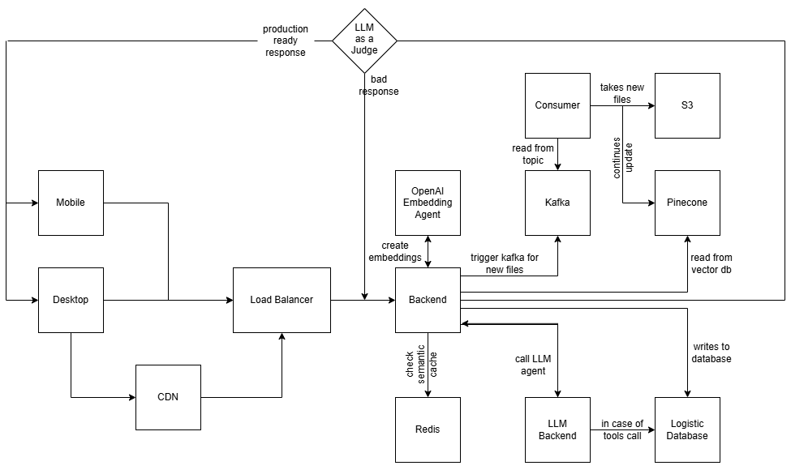

# Multi-Agent RAG Platform at Scale

## Questions to cover

*   Retrieval layer — embedding model + vector store choice, sharding/index type (e.g., HNSW/IVF) for 50M docs, hybrid (lexical + dense) retrieval, and reranking.
    
*   Agent orchestration — how agents coordinate, pass state, handle tool failures, time-outs, and partial results; how you bound cost/latency (parallel vs sequential calls, early-exit).
    
*   Freshness — keeping the index current under continuous updates without full reindexing; handling deletes/tenant data removal.
    
*   Evaluation & observability — offline eval (faithfulness, answer relevance, retrieval precision/recall) and online monitoring (drift, hallucination/groundedness checks, per-tenant quality), plus how you’d run A/Bs and roll back a bad model.
    
*   Reliability & cost — caching (semantic cache?), fallbacks when the LLM provider degrades, rate limiting, and the dominant cost drivers + how you’d cut them.
    

## Non Functional Requirements

*   System should handle 2000 QPS
    
*   P95 requests should be less than 3s
    
*   System should be able to handle 50M documents
    
*   System should be scalable as it’s continues improving
    
*   System should be able to handle strict tenant solution, so no user can see other user data even with the prompt injection
    

## Functional Requirements

Let’s assume, it’s b2b customers

We are going with the example of software house shifting it’s office to from one city to another city and they need logistics service, so we are making a enterprise logistic support chatbot.
    
*   Business can book logistic service,
    
*   Business will tell what they have, what they want to move, and when they want to move
    
*   Business can see the estimate of complete service
    
*   Business can track where the logistic is reached,
    
*   Business can see it’s history as well
    

## Storage Estimation

So, first we need to find the exact size of each document.

We will do back of the envelope calculation here.

Let’s assume that one document is 1MB on avg. So 50M docs \* 1mb = 50TB

So, we need this much storage to store this data.Now let’s assume that there is two things

*   We need to store raw documents as well, in case of data lost, so we can run one pipeline and it again creates the embedding and store it.
    
    *   For storage, we will need blob storage, so s3 works best here.
        
    *   S3 with 100TB storage is good, because the data is growing continuously.
        
*   Second, we need to store the embeddings in the pinecone as well.
    

## Where to store data and why?

*   I choose pinecone, because it’s help in freshness of the data.
    
*   Blob storage is needed for the raw data.
    
*   Postgres for orders data, like to store the history etc
    

## System Flow

We will divide this flow in multiple steps.

The simple step:

*   User will write his query and press enter.
    
*   Along side Chat ID and authorization token, query will be passed too.
    
*   First api will authorize the user.
    
*   After it, we need to check that whether that ChatID exists or not.
    
*   After it, we will retrieve the chatID all the messages, which will be used as context, this will happen on the backend, so chatID and it’s messages will come on one call.
    
*   After that, we will have way to check semantic cache.
    
*   For Semantic cache, we will create the embeddings using the OpenAI API. and check it in the redis.
    
*   Note: Redis has a semantic cache feature now.
    
*   If the query is already answer, then no need to pass the tools, just call the LLM. for final output. We will check this with cosine similarity feature.
    
*   For queries, which expire instantly based on the data. Like what is the status of the truck, it expires, so here we will set it’s TTL.
    
*   If cache has no answer, then use the embeddings of the query, retrieve the data from the vector db, then call the LLM along side the tools, system prompt and structured output, retrieval data and query.
    
*   And if there is need to calls the tools, LLM will give us the tool name and we will call it, pass it output to llm again for final answer.
    

Extra Steps:

*   Here we need to actually use light weight LLM as a judge, so we wont pass the final answer to production.
    
*   We need LLM as judge to choose a model based on the query, if the model is just a simple text generation, so choose a light weight model.
    
*   If tools calls happening, so we need to send the hint to users that whats happening., like hint shows “Check the status of your order” or “Retrieving all your orders.”
    

## System Architecture

This is very important part, the items it consist is mention below

*   Mobile App, Desktop Application
    
*   CDN
    
*   Load Balancers
    
*   Servers to host a backend,
    
*   Databases -> PostgreSQL & Pinecone
    
*   File Storage S3
    
*   Backends
    
*   Agents
    
    *   One agent is needed for to retrieve in concurrent
        
    *   One agent is to check that answer is production ready or not
        
*   Kafka
    
    *   which triggers the event and set the docs id in the topic,
        
    *   Consumer will take it, and create embeddings and update the vector db
        
## System Architecture Diagram

## Retrieval Layer

Let’s cover the retrieval layer, how to solve these problems.

*   Embedding Model is actually text-embedding-3-small.
    
    *   I just read the open ai docs that they released these two models. This is cheaper.
        
*   Pine cone can be our vector db, because of it’s feature of freshness.
    
    *   I read this somewhere online.
        
*   For Sharding, 50M docs is too much. Even the data is too much.
    
    *   So, either shard based on the document id, or divide whole document with the dates group by month, or year.
        
    *   For example the 2026 will go into one shard.
        
    *   And if there is hot shard, then divide it further by 6 months, and divide same way in hot shard and go nested.
        
*   Reranking can be done based on the date for the document.
    
*   Hybrid Retrieval can be done based on the shard ID as lexical and data as dense.
    
    *   So we need to determine using the light weight llm that which shard have the data, so the retrieval will be fast, because shard have the less data.
        

## Agent Orchestration

*   Agents will coordinate in a same way like airflow DAG works.
    
*   There will be one orchestrator which understand that which agent have worked and where is the state now.
    
*   He will keep track of whole DAG.
    
*   If one tool fails, here, we will have the feature of retries with exponential backoff or jitter.
    
*   Time outs are always needed, because one agent should not remain in always wait state.
    
*   There should be a criteria to pass the agents answer, so let’s say we have benchmark that if 5 agents works properly, that answer comes is ready for to pass the LLM. So partial results will cover here.
    
*   For to reduce the cost, we need to pick the different models for different query, let’s say if the query have keywords check like explain, demonstrate, so pass the expensive model to the LLM.
    
*   There is one easy solution here, like any cheapest model, like chinese model which can determine that this query needs to call which model. So this way, we can reduce our cost.
    
*   For the latency, we need to work in the parallel, which is not dependent to each other.
    
*   But in our Case, one agent is dependent on other.
    

## Freshness:

*   Index can help on the shard ID, so only the shard which is selected, we will get that data of the shard in O(log(n))
    
*   Now, Pinecone is here which helps us with continues updates without reindexing.
    

## Evaluation & observability

*   Offline Evaluation is that we can run some tests on the outputs of the model.
    
*   Tests can perform in multiple ways.
    
    *   First option is that to run it manually using the queries, like human in a loop.
        
    *   Second option is to automate it with different sets of the queries.
        
    *   Using LLM as judge, we can test it as well.
        
*   Online monitoring is needed to check the drift, hallucinations.
    
*   For hallucinations, actually we can again use LLM as judge.
    
*   For A/B testings, like OpenAI, openAI gives two output, and we select it, we will also do it, we will pass two answers based on query. And user will select whcih one is good, and then our model, start behaving on that feedback.
    

## Reliability & Cost

*   For Semantic cache, we will create the embeddings using the OpenAI API. and check it in the redis.
    
*   Note: Redis has a semantic cache feature now.
    
*   If the query is already answer, then no need to pass the tools, just call the LLM. for final output. We will check this with cosine similarity feature.
    
*   For queries, which expire instantly based on the data. Like what is the status of the truck, it expires, so here we will set it’s TTL.
    
*   The fallback should be on any good model, in case of our LLM degrades the output or user give bad feedback.
    
*   Rate limit is always needed, otherwise the cost on the company can be increase in case hacker automate it. So any good rate limit algorithm can be chosen. We can choose the Token Bucket Algorithm.
    

## Two Risks

1.  First risk i have in mind at a stage of retrieval layer, like it can halucinate actually.
    
    1.  So in my project which i did for the RAG, i strictly tries to retrieve answer from vector DB.
        
    2.  If data is not here, return with clear query to LLM, plus trained it properly and strictly disallow it to answer from it’s own data.
        
    3.  If data is not in the db, say that i don’t have this.
        
    4.  This is the solution i have in mind, but better solution is that,
        
    5.  When we will be using the LLM as judge, it will automatically look into the answer that it halucinated or not.
        
    6.  This way, we can get rid of bad Answer.
        
2.  Second issue i have in mind is wrong Shard ID,
    
    1.  This also connects with the hallucinations.
        
    2.  So if data is not in the shard ID, so it will not return results.
        
    3.  So judge LLM will not allow this query to go into production, and we will come on the fall back and we will retry.
        

## Appendix: Raw Notes to understand the problem

Okay, let me make this question in a easy way to first understand it quickly.

Okay, so we need to design a rag chatbot for the logistics enterprise support, logistics is for planning, execution, management, storage, handling, services of the goods.

It will have multiple parts, in technical way

*   We need to store the data in the form of embeddings in some database, i would choose pgvector db here, for embeddings, any llm, like open ai embeddings api can be used here, best option as well is opensearch knn here, i think open search is needed here due to some kind of filterings, but filtering works mostly in the stock market or where we have some kind of unique id, let’s say you need to search the news of AAPL, so opensearch KNN filtering can happen for the AAPL, so news will only be search for the AAPL, not other stocks, but we need to decide where we will use it here or not.
    
*   So embedding model and vector store choice can be cover here,
    
*   Sharding is needed actually because it’s 50M docs and setting 50M in one db is very slow, so create chunking for each id, and creates sharding, we will do some calculations later on to select how many shards we need, okay
    
*   Okay, i was looking into this thing (hybrid (lexical + dense) retrieval), so i found out we need opensearch knn here, because lexical is same like search on some kind of unique id, and dense is in that unique id, pass everything, so it’s done,
    
*   Okay this system shuold have reranking as well, so we need event base trigger system, which adds thing in the vector store db, so this way, data can be the big and in sorted way, so sort by date can be the option for reranking,
    
*   That covers the retrieval layer,
    
*   Now comes on the agent orchestration
    
*   Agent orchestration is actually that multiple agents does it work, so let’s say we have chatbot, it has multiple agents, each agents does each work, like one gets the data, one retrieves, one answer, i think my understanding be wrong here.
    
*   It has multiple words, pass state means that each node in a graph talks to other using context, our system knows at which state our agent is, which is failed, etc etc,
    
*   Handle tools failures, so we had some tools, first tool failures we need to add exponential backoff or jitter, i think exponential backoff with some retries is okay, like 3 retries, after some retries, if still failed, pass the answer to llm, so llm knows that it has failed and tries to retrieve data, so llm can handle some good query to user with a good user experience,
    
*   We need to add some time outs max, because time out is necessary here, like agent should not wait always for one task adn other does the tasks,
    
*   Partial results keyword is there as well, so it means that agents should have worked in case of scatter and gather or fan-out architecture, so if one failed, still system should work,
    
*   For the freshness, pinecone have this feature that it dont get full reindexing with continues updates
    
*   Okay, so offline eval is actually that we test our model output with some golden data sets to see what whether it is production ready or not
    
*   And faithfull ness is like another llm, less cost llm as a judge checks that whether the output is exactly what user wants, etc etc,
    
*   Then it comes the online monitoring, using tools, so first keyword is drift, which is actually like gradually decline in performance.
    
*   For halucinations checks, we can also use llm as judge
    
*   Per  tenant quality is that, one user can’t see the data of other user
    
*   Then comes the cost and reliability, it has first word is semantic check, so semantic check is that, you create some kind of embeddings and check it with the context that this answer has already been answers, so you check cosine similarity and if it is greater than 95, then don’t need to call the tools, just answer from your own answer
    
*   Rate limit is needed, for security reasons,